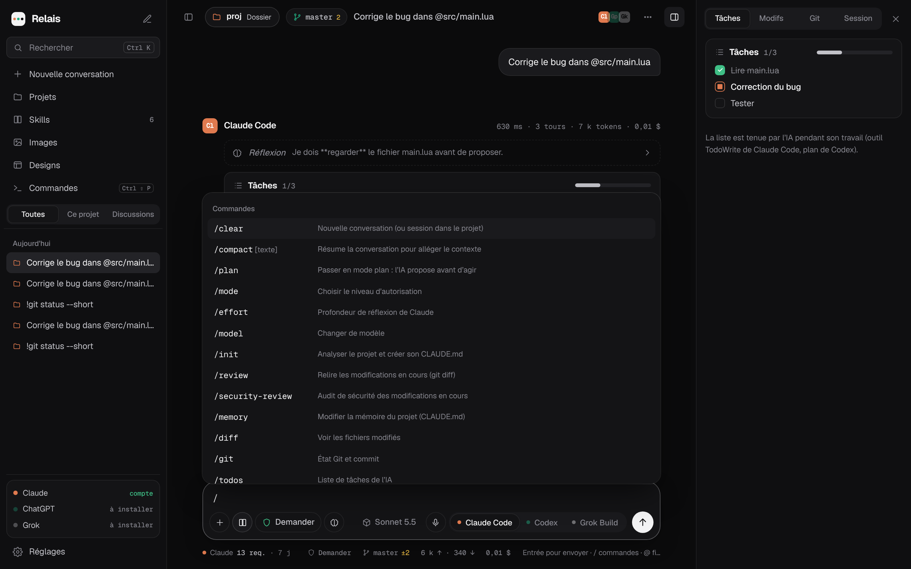
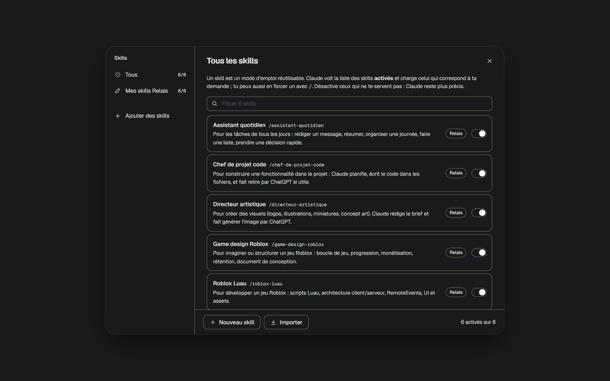

# Relais

**Un hub IA local et portable pour Windows : Claude, ChatGPT et Grok dans une seule fenêtre, connectés à tes propres comptes.**

Claude dirige les autres : tu écris simplement ce que tu veux, et Relais envoie la demande à la bonne IA. ChatGPT pour les images, Grok pour un autre avis, Claude pour le code. Tout tourne sur ton PC, dans un seul dossier, sans installer les applications de chaque IA.

| IA | Rôle | Sans rien installer | Avec ton abonnement (outil officiel) |
|---|---|---|---|
| Claude | chef d'orchestre, écrit le code de ton projet | clé OpenRouter ou clé API Anthropic | Claude Code (Pro/Max) |
| ChatGPT | images, second avis, relecture | clé OpenRouter ou clé API OpenAI | Codex (ChatGPT) |
| Grok | avis différent | clé OpenRouter ou clé API xAI | Grok Build (SuperGrok / X Premium+) |
| Cursor *(option)* | agent de code | `cursor-agent` | compte Cursor |

> Relais est un projet personnel. Il n'est pas affilié à Anthropic, OpenAI, xAI ni Cursor, et passe uniquement par leurs outils officiels ou leurs API (directement ou via OpenRouter).


---

## Aperçu



| Menu « Relais » : déléguer une tâche | Connexions aux comptes |
|---|---|
|  |  |

| Skills |
|---|
|  |

---

## Fonctionnalités

- **Demandes en langage naturel** : Claude comprend à qui confier quoi.
  - « dessine un logo pour mon jeu » → Claude écrit le prompt, ChatGPT génère l'image
  - « demande à Grok ce qu'il pense de… » → Grok répond, Claude commente
  - « compare l'avis de ChatGPT et Grok » → les deux répondent en parallèle, Claude tranche
  - `@ChatGPT`, `@Grok`, `@Image`, `@design` → force l'IA ou le mode voulu
- **Coder dans un projet** : choisis un dossier (par exemple un jeu Roblox synchronisé avec Rojo). Claude Code, Codex ou Grok Build y travaillent directement, chacun avec sa propre session.
- **Les modes d'autorisation de Claude Code** : *Lecture seule*, *Mode plan* (l'IA propose un plan, tu l'approuves avant toute modification), *Demander* (chaque modification est montrée avec son diff), *Accepter les modifs* (fichiers sans confirmation, commandes soumises à ton accord) et *Accès complet*. `Maj+Tab` passe de l'un à l'autre, comme dans Claude Code.
- **Interface façon Claude Code desktop** :
  - commandes `/` : `/clear`, `/compact`, `/plan`, `/init`, `/review`, `/security-review`, `/memory`, `/model`, `/effort`, `/diff`, `/export`, `/fork`, `/resume`, `/mcp`, `/help`…
  - `@fichier` pour mentionner un fichier du projet, `!commande` pour lancer une commande dans le dossier (ex. `!git status`)
  - palette de commandes (`Ctrl Maj P`), recherche dans le contenu des conversations (`Ctrl P`)
  - panneau de travail (`Ctrl J`) : liste de tâches de l'IA, fichiers modifiés avec leur diff, état Git et commit, statistiques de la session
  - réflexion de Claude visible, niveau de réflexion réglable (normal, approfondi, maximum), tokens, tours et coût sous chaque réponse
  - pièces jointes (bouton +, glisser-déposer, coller une capture), file d'attente des messages pendant une réponse, modifier et renvoyer un message, dupliquer une conversation, export Markdown
  - mémoire du projet (`CLAUDE.md` / `AGENTS.md`) modifiable dans l'app, serveurs MCP supplémentaires pour Claude Code
  - notifications et son de fin quand Relais est en arrière-plan
- **Comme l'app Claude desktop** : styles de réponse (normal, concis, explicatif, formel, créatif), recherche web, réflexion approfondie, **mémoire** entre les conversations (« retiens que… », modifiable dans Réglages → Mémoire), aperçu des blocs HTML, SVG et diagrammes Mermaid, enregistrement d'un bloc de code dans un fichier, capture d'écran en pièce jointe, « Relancer avec » une autre IA, raccourci global `Ctrl+Alt+Espace` pour afficher Relais depuis n'importe où (Relais.exe).
- **Les IA se parlent, en direct** : quand Claude consulte ChatGPT ou Grok, un faisceau animé relie leurs avatars ; la demande part, la réponse revient, et les IA en conversation s'animent dans la barre du haut.
- **Voix** : dictée au micro (`Ctrl M`), conversation vocale (clic long sur le micro ou `/talk` : Relais envoie à chaque pause et lit la réponse à voix haute), lecture à voix haute de n'importe quelle réponse. Transcription par la reconnaissance vocale de Windows (hors ligne, gratuite), par l'API OpenAI si une clé est enregistrée (plus précise), ou par le navigateur hors de `Relais.exe`.
- **Actions « Relais »** : image, icône de jeu, miniature 16:9, table ronde entre IA, script Luau…
- **Skills** : des fichiers Markdown que Claude charge tout seul quand ils servent, plus l'import de skills depuis ton compte Claude ou depuis GitHub.
- **Designs** : des maquettes HTML interactives avec aperçu en direct, des versions successives et l'export vers ton projet.
- **Premier lancement guidé** : une courte animation (le « R » de Relais se trace, les trois IA s'allument, « Relais » s'écrit en signature), puis un assistant de configuration en six étapes : prénom et apparence, connexion des comptes, préférences de travail, voix, premier projet. Il se relance avec `/setup` ou depuis Réglages → Général.
- **Application Windows** : une fenêtre WebView2 sans bordure qui reste active dans la zone de notification quand tu la fermes.
- **Portable** : Node, les outils, les connexions et les données vivent dans le dossier.

## Prérequis

- Windows 10 ou 11 (WebView2 est déjà présent sur Windows 11)
- [Node.js](https://nodejs.org) 18.17 ou plus récent, installé sur le PC **ou** en version portable dans `node/`
- Un compte ou une clé API pour au moins une des IA

## Installation

```bash
git clone https://github.com/Underspace1/relais.git
cd relais
```

1. **Node.js** : soit Node est installé sur le PC, soit tu télécharges l'archive « Windows Binary (.zip) » sur [nodejs.org](https://nodejs.org/en/download) et tu mets son contenu dans `node/` (`node/node.exe`).
2. **Le lanceur** (optionnel, recommandé) : compile `Relais.exe` avec le compilateur C# fourni avec Windows :

   ```bash
   powershell -ExecutionPolicy Bypass -File launcher\build.ps1
   ```

3. **Les clés API** (optionnel) : copie `.env.example` en `.env` et remplis les clés. Tu peux aussi les saisir dans l'app (Réglages → Connexions).

Aucune dépendance npm à installer : le serveur n'utilise que Node.

## Lancer

- **`Relais.exe`** : démarre le serveur en arrière-plan et ouvre l'interface dans sa propre fenêtre. Fermer la fenêtre laisse Relais actif près de l'horloge. Double-clic sur l'icône pour rouvrir, clic droit → *Quitter Relais* pour tout arrêter.
- **`demarrer.bat`** : solution de secours qui ouvre l'interface dans ton navigateur, avec une console.
- **Manuellement** : `npm start`, puis ouvre <http://127.0.0.1:4321>.

## Connecter tes IA

### Le plus simple : une clé OpenRouter (rien à installer)

1. Crée une clé sur [openrouter.ai/keys](https://openrouter.ai/keys) et ajoute un peu de crédit.
2. Réglages → **Connexions** → colle la clé dans la carte **OpenRouter** → *Enregistrer*.

C'est tout : Claude, ChatGPT et Grok passent par cette clé, images comprises. Aucun outil n'est téléchargé. Pour coder dans un projet, Relais utilise son **agent de code intégré** (lire, chercher, modifier les fichiers, lancer des commandes), avec les mêmes modes d'autorisation que Claude Code. Relais choisit automatiquement le modèle le plus récent de chaque IA ; tu peux en imposer un dans *Modèles utilisés via OpenRouter*. Facturé à l'usage par OpenRouter.

Tu peux aussi mélanger : chaque IA a son propre mode (*Mon compte*, *OpenRouter* ou *Clé API*).

### Avec tes abonnements (outils officiels)

Réglages → **Connexions**, pour chaque IA, mode **Mon compte** :

1. **Installer** : télécharge l'outil officiel dans `tools/` (Claude Code ≈ 355 Mo, Codex ≈ 490 Mo, Grok Build via le script officiel de xAI).
2. **Se connecter** : ton navigateur s'ouvre pour te connecter à ton compte.
3. **Tester** : envoie un message de test.

Chaque IA peut aussi être branchée par **clé API** (rien à installer non plus, agent intégré pour les projets). Les images Grok passent par une clé API xAI ou par OpenRouter.

Bon à savoir :
- Claude Code en mode automatique consomme le crédit « Agent SDK » inclus dans les abonnements Pro et Max (séparé de la limite du chat).
- Générer des images avec ChatGPT via Codex consomme les limites de l'abonnement plus vite qu'un message texte.

## Configuration

Les variables de `.env.example` :

| Variable | Rôle | Défaut |
|---|---|---|
| `OPENROUTER_API_KEY` | clé OpenRouter (mode OpenRouter, rien à installer) | vide |
| `OPENROUTER_CLAUDE_MODEL`, `OPENROUTER_GPT_MODEL`, `OPENROUTER_GROK_MODEL`, `OPENROUTER_IMAGE_MODEL` | modèles OpenRouter | vide = le plus récent |
| `ANTHROPIC_API_KEY`, `OPENAI_API_KEY`, `XAI_API_KEY` | clés API (mode clé API) | vide |
| `CLAUDE_MODEL` | modèle Claude | `claude-sonnet-5-5` |
| `OPENAI_MODEL`, `OPENAI_IMAGE_MODEL` | modèles OpenAI | `gpt-5`, `gpt-image-1` |
| `GROK_MODEL`, `GROK_IMAGE_MODEL` | modèles xAI | `grok-4`, `grok-2-image` |
| `CURSOR_ENABLED`, `CURSOR_WORKSPACE`, `CURSOR_COMMAND`, `CURSOR_ALLOW_WRITES` | agent Cursor | désactivé |
| `VOICE_ENGINE`, `VOICE_LANG`, `VOICE_OPENAI_MODEL` | dictée : moteur (`auto`, `windows`, `openai`), langue, modèle OpenAI | `auto`, `fr-FR`, `gpt-4o-mini-transcribe` |
| `PORT` | port du serveur local | `4321` |

## Structure

```
server.js             serveur HTTP local + flux en direct
lib/connectors.js     outils officiels : installation, connexion, exécution
lib/orchestrator.js   logique de délégation (modes compte et clé API)
lib/mcp-bridge.js     pont MCP : donne à Claude Code les outils de Relais
lib/coders.js         agents de code dans un projet (Claude Code, Codex, Grok Build)
lib/relays.js         actions « Relais »
lib/skills.js         skills : lecture, packs, activé/désactivé
lib/skill-import.js   import depuis le compte Claude et GitHub
lib/designs.js        maquettes HTML (aperçu, export vers le projet)
lib/providers.js      appels API directs
lib/workspace.js      fichiers du projet, Git, CLAUDE.md, commandes « ! », MCP, pièces jointes
lib/voice.js          transcription de la voix (Windows ou OpenAI)
lib/llm.js            appels directs : OpenRouter et clés API (flux, outils, images)
lib/agent.js          agent de code intégré (sans Claude Code, Codex ni Grok Build)
public/               interface web (public/voice.js : micro et lecture à voix haute)
skills/               skills Relais (Markdown)
launcher/             lanceur Windows (C# + WebView2) et script de compilation
docs/screenshots/     captures d'écran du README
```

Créés à l'utilisation et exclus du dépôt : `node/` (Node portable), `tools/` (outils officiels), `data/` (connexions, conversations, images, réglages) et `skills/packs/` (skills importés).

## Sécurité et vie privée

- Le serveur écoute uniquement sur `127.0.0.1` : il n'est pas accessible depuis le réseau.
- Tes connexions aux comptes sont dans `data/accounts/`. Supprimer ce dossier déconnecte tout. **Ne partage jamais ce dossier.**
- Les dossiers trop larges (disque entier, dossier utilisateur, Bureau, Documents…) sont refusés comme dossier de projet.
- En *Accès complet*, les agents modifient ton projet sans confirmation : garde une sauvegarde (Git).
- Le micro n'est autorisé que pour l'interface locale de Relais ; avec le moteur Windows, la voix ne quitte pas ton PC.
- Les commandes `!` s'exécutent dans le dossier du projet avec tes droits : ce sont tes commandes, comme dans un terminal.

## Crédits

- Fenêtre : [Microsoft Edge WebView2](https://developer.microsoft.com/microsoft-edge/webview2/). Les bibliothèques redistribuables du SDK sont dans `launcher/lib/`.
- Les skills importés gardent la licence de leur dépôt d'origine.
