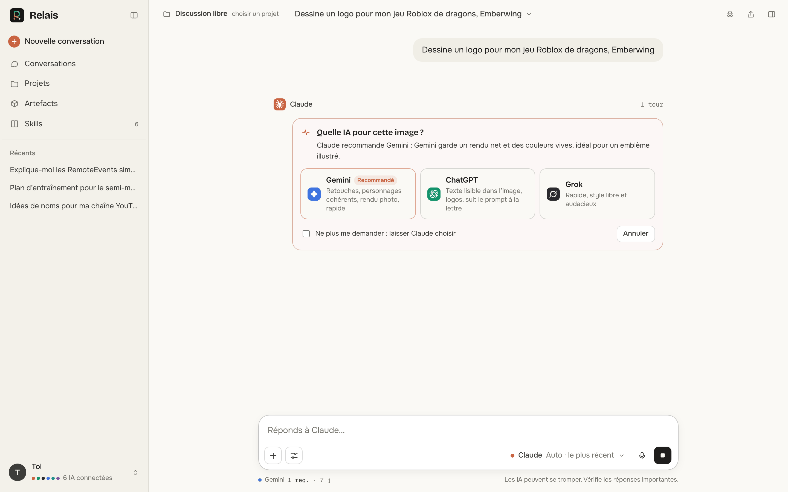
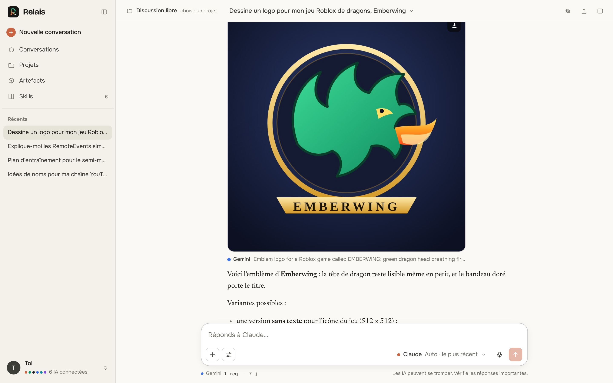
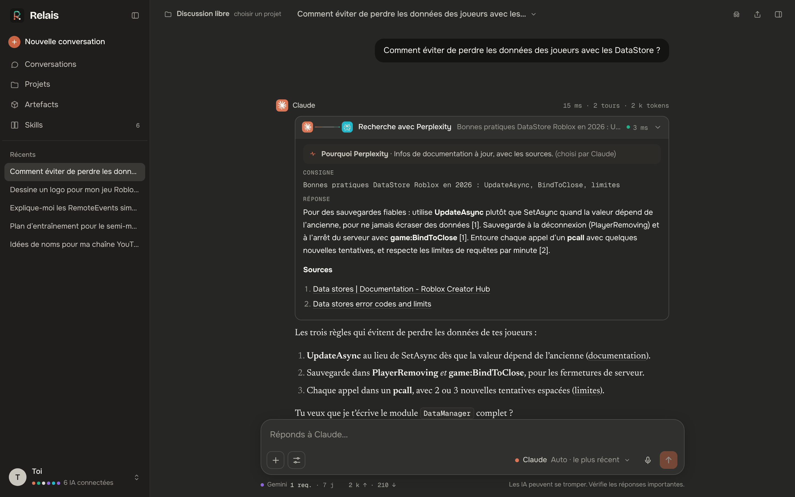
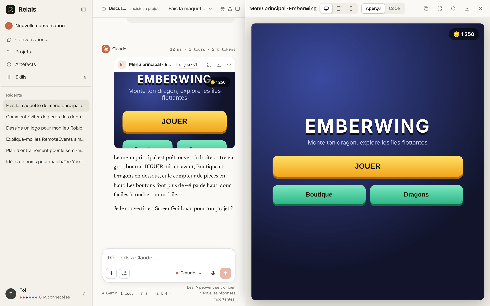
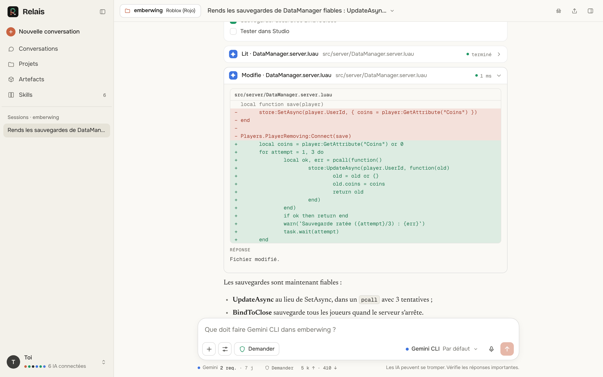
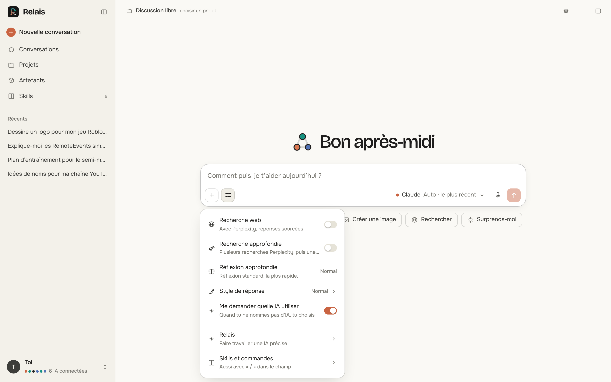
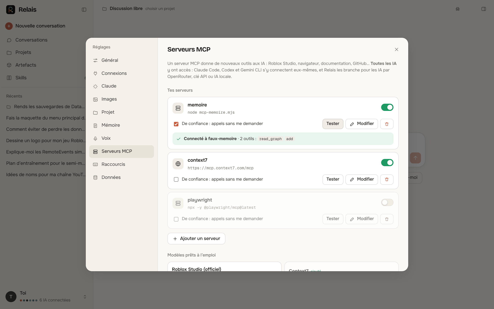
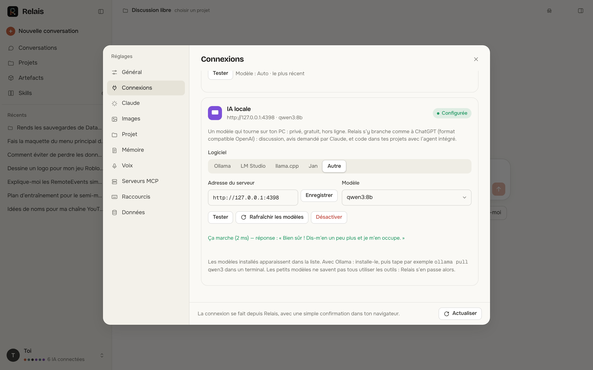
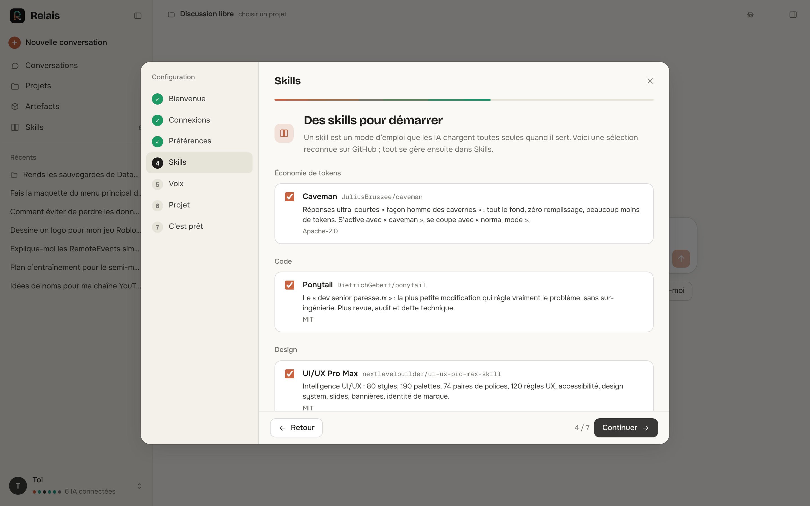

# Relais

**Un hub IA local et portable pour Windows : Claude, ChatGPT, Grok, Gemini, Perplexity et ton IA locale dans une seule fenêtre, connectés à tes propres comptes.**

Claude dirige les autres : tu écris simplement ce que tu veux, et Relais envoie la demande à la bonne IA. Gemini pour les images, Perplexity pour les recherches, ChatGPT et Grok pour un autre avis, Claude pour le code. Tout tourne sur ton PC, dans un seul dossier, sans installer les applications de chaque IA.

| IA | Rôle | Sans rien installer | Avec ton abonnement (outil officiel) |
|---|---|---|---|
| Claude | chef d'orchestre, écrit le code de ton projet | clé OpenRouter ou clé API Anthropic | Claude Code (Pro/Max) |
| ChatGPT | images, second avis, relecture | clé OpenRouter ou clé API OpenAI | Codex (ChatGPT) |
| Grok | avis différent | clé OpenRouter ou clé API xAI | Grok Build (SuperGrok / X Premium+) |
| Gemini | images (Nano Banana) et retouches, autre avis, code | clé OpenRouter ou clé API Google (AI Studio) | Gemini CLI (compte Google, Google AI Pro / Ultra) |
| Perplexity | recherches sur le web, avec les sources | clé OpenRouter ou clé API Perplexity | — (pas d'outil officiel) |
| IA locale | privé, gratuit, hors ligne | Ollama, LM Studio, llama.cpp, Jan (tout serveur compatible OpenAI) | — |
| Cursor *(option)* | agent de code | `cursor-agent` | compte Cursor |

> Relais est un projet personnel. Il n'est pas affilié à Anthropic, OpenAI, xAI, Google, Perplexity ni Cursor, et passe uniquement par leurs outils officiels ou leurs API (directement ou via OpenRouter).


---

## Aperçu

### Le pont entre les IA
Tu demandes un logo sans nommer d'IA : Relais te propose Gemini, ChatGPT ou Grok, avec la recommandation de Claude et sa raison. L'image arrive, et l'étape garde la trace du choix.

| Choisir l'IA | Le résultat |
|---|---|
|  |  |

### Recherche avec sources
Claude confie la recherche à Perplexity et répond en citant la documentation (thème sombre).



### Artefacts à côté de la conversation
Les maquettes s'ouvrent dans un panneau à droite, avec les onglets Aperçu et Code.



### Coder dans un projet
Ici Gemini CLI travaille dans un projet Roblox (Rojo) : liste de tâches, modification montrée avec son diff, résumé.



### Outils, MCP, IA locale et skills

| Le menu Outils | Serveurs MCP pour toutes les IA |
|---|---|
|  |  |

| IA locale (Ollama, LM Studio…) | Skills proposés à la configuration |
|---|---|
|  |  |


---

## Fonctionnalités

- **Demandes en langage naturel** : Claude comprend à qui confier quoi.
  - « dessine un logo pour mon jeu » → Claude écrit le prompt, Gemini génère l'image (moteur par défaut, modifiable)
  - « change le fond de cette image » → Gemini retouche l'image jointe ou la dernière générée
  - « cherche le prix de… », « quoi de neuf sur… » → Perplexity cherche sur le web, Claude répond avec les sources
  - « demande à Grok ce qu'il pense de… » → Grok répond, Claude commente
  - « compare l'avis de ChatGPT et Grok » → les deux répondent en parallèle, Claude tranche
  - « compare l'avis de ChatGPT, Grok et Gemini » → table ronde, Claude tranche
  - `@ChatGPT`, `@Grok`, `@Gemini`, `@Perplexity`, `@Image`, `@design` → force l'IA ou le mode voulu
- **Coder dans un projet** : choisis un dossier (par exemple un jeu Roblox synchronisé avec Rojo). Claude Code, Codex, Grok Build ou Gemini CLI y travaillent directement, chacun avec sa propre session. Claude peut aussi confier une sous-tâche à Gemini (`gemini_task`) ou une recherche de documentation à Perplexity.
- **Les modes d'autorisation de Claude Code** : *Lecture seule*, *Mode plan* (l'IA propose un plan, tu l'approuves avant toute modification), *Demander* (chaque modification est montrée avec son diff), *Accepter les modifs* (fichiers sans confirmation, commandes soumises à ton accord) et *Accès complet*. `Maj+Tab` passe de l'un à l'autre, comme dans Claude Code.
- **Les outils de Claude Code** :
  - commandes `/` : `/clear`, `/compact`, `/plan`, `/init`, `/review`, `/security-review`, `/memory`, `/model`, `/effort`, `/diff`, `/export`, `/fork`, `/resume`, `/mcp`, `/help`…
  - `@fichier` pour mentionner un fichier du projet, `!commande` pour lancer une commande dans le dossier (ex. `!git status`)
  - palette de commandes (`Ctrl Maj P`), recherche dans le contenu des conversations (`Ctrl K` ou `Ctrl P`)
  - panneau de travail (`Ctrl J`) : liste de tâches de l'IA, fichiers modifiés avec leur diff, état Git et commit, statistiques de la session
  - réflexion de Claude visible, niveau de réflexion réglable (normal, approfondi, maximum), tokens, tours et coût sous chaque réponse
  - pièces jointes (bouton +, glisser-déposer, coller une capture), file d'attente des messages pendant une réponse, modifier et renvoyer un message, dupliquer une conversation, export Markdown
  - mémoire du projet (`CLAUDE.md` / `AGENTS.md`) modifiable dans l'app
  - notifications et son de fin quand Relais est en arrière-plan
- **Recherche web avec Perplexity** : Claude lui confie toute question d'actualité ou vérifiable, et cite les sources. Le bouton « recherche web » passe par Perplexity quand il est connecté. Tu peux aussi écrire directement à Perplexity (sélecteur sous le champ de message).
- **Images avec Gemini (Nano Banana)** : moteur par défaut, avec repli automatique sur ChatGPT ou Grok. Gemini retouche aussi une image existante : joins-la (ou reprends la dernière générée) et décris la modification.
- **Le pont entre les IA, expliqué** : chaque relais affiche pourquoi telle IA a été choisie. Quand tu ne nommes pas d'IA (« dessine un logo »), Relais te propose de choisir (Gemini, ChatGPT ou Grok pour une image ; ChatGPT, Grok, Gemini ou ton IA locale pour un avis) avec la recommandation de Claude et ses raisons. Ou passe en **automatique** : Claude choisit selon les forces de chacune et l'explique (Réglages → Claude, ou menu Outils).
- **Serveurs MCP pour toutes les IA** : Réglages → Serveurs MCP. Modèles prêts à l'emploi (**Roblox Studio** officiel, Context7, navigateur Playwright, fichiers, GitHub, mémoire, réflexion pas à pas), formulaire d'ajout, bouton Tester (liste les outils), activer ou couper, et « de confiance » (sinon chaque appel te demande ton accord). Claude Code, Codex et Gemini CLI s'y connectent eux-mêmes ; pour les IA par OpenRouter, clé API ou IA locale, c'est Relais qui se connecte aux serveurs (stdio et HTTP).
- **IA locale** : branche Ollama, LM Studio, llama.cpp ou Jan (Réglages → Connexions → IA locale). Relais liste les modèles installés ; tu peux lui écrire directement, Claude peut lui demander un avis (`@locale`), et elle code dans tes projets avec l'agent intégré. Les petits modèles qui ne gèrent pas les outils marchent aussi.
- **Identité Relais** : tons chauds (ivoire le jour, brun-gris la nuit), polices Onest (interface), Bricolage Grotesque (titres) et Newsreader (réponses, réglable), marque « trois IA reliées » sur l'accueil, accueil centré avec des suggestions (Écrire, Apprendre, Code, Créer une image, Rechercher, Surprends-moi), champ de message épuré : `+` pour joindre, un seul menu **Outils** (recherche web, recherche approfondie, réflexion, style, relais, skills) dont les options actives s'affichent en pastilles, et un bouton unique pour choisir l'IA et son modèle.
- **Les fonctions de Claude Desktop** :
  - barre latérale : Nouvelle conversation, Conversations, Projets, Artefacts, Skills ; **Favoris** puis **Récents** ; ton profil en bas, avec l'état des IA et un menu (réglages, connexions, utilisation, apparence, aide)
  - page **Conversations** : recherche dans les titres et le contenu, favoris, sélection et suppression groupée
  - **conversation privée** (`Ctrl Maj I`) : ni enregistrée, ni ajoutée à la mémoire
  - menu du titre : favori, renommer, dupliquer, résumer, exporter, supprimer ; bouton d'export en haut à droite
  - **artefacts** dans un panneau à droite de la conversation, avec les onglets Aperçu et Code, la copie, le plein écran ; page Artefacts qui réunit designs et images
  - modifier un message directement dans sa bulle, avis 👍 / 👎 sur chaque réponse
  - profil : « ce qui te décrit le mieux », pris en compte par les IA
  - raccourcis : `Ctrl K` chercher, `Ctrl Maj O` nouvelle conversation, `Ctrl B` barre latérale, `Ctrl /` aide
- **Comme l'app Claude desktop** : styles de réponse (normal, concis, explicatif, formel, créatif), recherche web, réflexion approfondie, **mémoire** entre les conversations (« retiens que… », modifiable dans Réglages → Mémoire), aperçu des blocs HTML, SVG et diagrammes Mermaid, enregistrement d'un bloc de code dans un fichier, capture d'écran en pièce jointe, « Relancer avec » une autre IA, raccourci global `Ctrl+Alt+Espace` pour afficher Relais depuis n'importe où (Relais.exe).
- **Les IA se parlent, en direct** : quand Claude consulte ChatGPT ou Grok, un faisceau animé relie leurs avatars ; la demande part, la réponse revient, et les IA en conversation s'animent dans la barre du haut.
- **Voix** : dictée au micro (`Ctrl M`), conversation vocale (clic long sur le micro ou `/talk` : Relais envoie à chaque pause et lit la réponse à voix haute), lecture à voix haute de n'importe quelle réponse. Transcription par la reconnaissance vocale de Windows (hors ligne, gratuite), par l'API OpenAI si une clé est enregistrée (plus précise), ou par le navigateur hors de `Relais.exe`.
- **Actions « Relais »** : image (Gemini, ChatGPT, Grok), retouche d'image, recherche Perplexity simple ou approfondie, icône de jeu, miniature 16:9, table ronde entre IA, script Luau…
- **Skills** : des fichiers Markdown que Claude charge tout seul quand ils servent, plus l'import de skills depuis ton compte Claude ou depuis GitHub. L'assistant de configuration propose une sélection à installer en un clic : **Caveman** (réponses ultra-courtes, moins de tokens), **Ponytail** (la plus petite modification qui règle le problème), **UI/UX Pro Max** (design d'interfaces) et les skills **Roblox** (Roblox Brain, Awesome GameDev, Roblox Game).
- **Designs** : des maquettes HTML interactives avec aperçu en direct, des versions successives et l'export vers ton projet.
- **Premier lancement guidé** : une courte animation (le « R » de Relais se trace, les trois IA s'allument, « Relais » s'écrit en signature), puis un assistant de configuration en six étapes : prénom et apparence, connexion des comptes, préférences de travail, voix, premier projet. Il se relance avec `/setup` ou depuis Réglages → Général.
- **Application Windows** : une fenêtre WebView2 sans bordure qui reste active dans la zone de notification quand tu la fermes.
- **Portable** : Node, les outils, les connexions et les données vivent dans le dossier.

## Télécharger (le plus simple)

Va dans les [**Releases**](https://github.com/Underspace1/relais/releases/latest) et télécharge **`Relais-Setup.exe`**, puis double-clique dessus. Tout est inclus (Node.js portable, WebView2 si besoin), sans droits administrateur. Windows peut afficher « Windows a protégé votre ordinateur » : clique sur *Informations complémentaires* → *Exécuter quand même* (l'installateur n'est pas signé).

Sans installation : `Relais-portable-windows.zip`, à décompresser, puis lance `Relais.exe`.

Les releases sont compilées automatiquement par GitHub Actions (`.github/workflows/release.yml`) à chaque étiquette `vX.Y.Z`.

## Installer depuis le code source

### Prérequis

- Windows 10 ou 11 (WebView2 est déjà présent sur Windows 11)
- [Node.js](https://nodejs.org) 18.17 ou plus récent, installé sur le PC **ou** en version portable dans `node/`
- Un compte ou une clé API pour au moins une des IA

### Installation

```bash
git clone https://github.com/Underspace1/relais.git
cd relais
```

1. **Node.js** : soit Node est installé sur le PC, soit tu télécharges l'archive « Windows Binary (.zip) » sur [nodejs.org](https://nodejs.org/en/download) et tu mets son contenu dans `node/` (`node/node.exe`).
2. **Le lanceur** (optionnel, recommandé) : compile `Relais.exe` avec le compilateur C# fourni avec Windows :

   ```bash
   powershell -ExecutionPolicy Bypass -File launcher\build.ps1
   ```

3. **Les clés API** (optionnel) : copie `.env.example` en `.env` et remplis les clés. Tu peux aussi les saisir dans l'app (Réglages → Connexions).

Aucune dépendance npm à installer : le serveur n'utilise que Node.

## Lancer

- **`Relais.exe`** : démarre le serveur en arrière-plan et ouvre l'interface dans sa propre fenêtre. Fermer la fenêtre laisse Relais actif près de l'horloge. Double-clic sur l'icône pour rouvrir, clic droit → *Quitter Relais* pour tout arrêter.
- **`demarrer.bat`** : solution de secours qui ouvre l'interface dans ton navigateur, avec une console.
- **Manuellement** : `npm start`, puis ouvre <http://127.0.0.1:4321>.

## Connecter tes IA

### Le plus simple : une clé OpenRouter (rien à installer)

1. Crée une clé sur [openrouter.ai/keys](https://openrouter.ai/keys) et ajoute un peu de crédit.
2. Réglages → **Connexions** → colle la clé dans la carte **OpenRouter** → *Enregistrer*.

C'est tout : Claude, ChatGPT, Grok, Gemini et Perplexity passent par cette clé, images comprises. Aucun outil n'est téléchargé. Pour coder dans un projet, Relais utilise son **agent de code intégré** (lire, chercher, modifier les fichiers, lancer des commandes), avec les mêmes modes d'autorisation que Claude Code. Relais choisit automatiquement le modèle le plus récent de chaque IA ; tu peux en imposer un dans *Modèles utilisés via OpenRouter*. Facturé à l'usage par OpenRouter.

Tu peux aussi mélanger : chaque IA a son propre mode (*Mon compte*, *OpenRouter* ou *Clé API*).

### Avec tes abonnements (outils officiels)

Réglages → **Connexions**, pour chaque IA, mode **Mon compte** :

1. **Installer** : télécharge l'outil officiel dans `tools/` (Claude Code ≈ 355 Mo, Codex ≈ 490 Mo, Grok Build via le script officiel de xAI, Gemini CLI ≈ 100 Mo).
2. **Se connecter** : ton navigateur s'ouvre pour te connecter à ton compte.
3. **Tester** : envoie un message de test.

Chaque IA peut aussi être branchée par **clé API** (rien à installer non plus, agent intégré pour les projets). Les images Grok passent par une clé API xAI ou par OpenRouter.

### Gemini et Perplexity

- **Gemini, mode Mon compte** : *Installer* Gemini CLI, puis *Se connecter* : une page Google s'ouvre dans ton navigateur, tu choisis ton compte et c'est fini. Gemini CLI demande **Node.js 20** ou plus récent. Il fait le texte et le code, pas les images : pour les images Gemini, ajoute en plus une clé API Google (champ sous la carte) ou une clé OpenRouter.
- **Gemini, mode Clé API** : clé gratuite sur [aistudio.google.com/apikey](https://aistudio.google.com/apikey). Le texte a un quota gratuit ; les images (Nano Banana) demandent d'activer la facturation sur le projet Google. Relais choisit tout seul le modèle Gemini Pro et le modèle d'images les plus récents.
- **Perplexity** : clé API sur perplexity.ai (Paramètres → API, facturée à l'usage) ou ta clé OpenRouter. Pas de mode compte : Perplexity n'a pas d'outil officiel. Perplexity cherche mais ne code pas : en projet, il sert à Claude pour les recherches.

Bon à savoir :
- Claude Code en mode automatique consomme le crédit « Agent SDK » inclus dans les abonnements Pro et Max (séparé de la limite du chat).
- Générer des images avec ChatGPT via Codex consomme les limites de l'abonnement plus vite qu'un message texte.
- Gemini CLI avec un compte Google gratuit a une limite quotidienne de requêtes ; Google AI Pro et Ultra la relèvent.

## Configuration

Les variables de `.env.example` :

| Variable | Rôle | Défaut |
|---|---|---|
| `OPENROUTER_API_KEY` | clé OpenRouter (mode OpenRouter, rien à installer) | vide |
| `OPENROUTER_CLAUDE_MODEL`, `OPENROUTER_GPT_MODEL`, `OPENROUTER_GROK_MODEL`, `OPENROUTER_GEMINI_MODEL`, `OPENROUTER_PERPLEXITY_MODEL`, `OPENROUTER_IMAGE_MODEL`, `OPENROUTER_GEMINI_IMAGE_MODEL` | modèles OpenRouter | vide = le plus récent |
| `ANTHROPIC_API_KEY`, `OPENAI_API_KEY`, `XAI_API_KEY`, `GEMINI_API_KEY`, `PERPLEXITY_API_KEY` | clés API (mode clé API) | vide |
| `CLAUDE_MODEL` | modèle Claude | `claude-sonnet-5-5` |
| `OPENAI_MODEL`, `OPENAI_IMAGE_MODEL` | modèles OpenAI | `gpt-5`, `gpt-image-1` |
| `GROK_MODEL`, `GROK_IMAGE_MODEL` | modèles xAI | `grok-4`, `grok-2-image` |
| `GEMINI_MODEL`, `GEMINI_IMAGE_MODEL` | modèles Google (clé API) | vide = le plus récent |
| `PERPLEXITY_MODEL` | modèle Perplexity (`sonar`, `sonar-pro`, `sonar-reasoning-pro`, `sonar-deep-research`) | `sonar-pro` |
| `LOCAL_URL`, `LOCAL_MODEL`, `LOCAL_KEY` | IA locale : adresse du serveur compatible OpenAI (ex. `http://127.0.0.1:11434/v1` pour Ollama), modèle, clé facultative | vide = désactivée |
| `BRIDGE_MODE` | quand tu ne nommes pas d'IA : `ask` (Relais te demande) ou `auto` (Claude choisit) | `ask` |
| `CURSOR_ENABLED`, `CURSOR_WORKSPACE`, `CURSOR_COMMAND`, `CURSOR_ALLOW_WRITES` | agent Cursor | désactivé |
| `VOICE_ENGINE`, `VOICE_LANG`, `VOICE_OPENAI_MODEL` | dictée : moteur (`auto`, `windows`, `openai`), langue, modèle OpenAI | `auto`, `fr-FR`, `gpt-4o-mini-transcribe` |
| `PORT` | port du serveur local | `4321` |

## Structure

```
server.js             serveur HTTP local + flux en direct
lib/connectors.js     outils officiels : installation, connexion, exécution
lib/orchestrator.js   logique de délégation (modes compte et clé API)
lib/mcp-bridge.js     pont MCP : donne à Claude Code les outils de Relais
lib/coders.js         agents de code dans un projet (Claude Code, Codex, Grok Build, Gemini CLI)
lib/relays.js         actions « Relais »
lib/skills.js         skills : lecture, packs, activé/désactivé
lib/skill-import.js   import depuis le compte Claude et GitHub
lib/designs.js        maquettes HTML (aperçu, export vers le projet)
lib/providers.js      appels API directs (dont les images Gemini)
lib/workspace.js      fichiers du projet, Git, CLAUDE.md, commandes « ! », MCP, pièces jointes
lib/voice.js          transcription de la voix (Windows ou OpenAI)
lib/mcp-client.js     client MCP (stdio et HTTP) : outils des serveurs MCP pour toutes les IA
lib/llm.js            appels directs : OpenRouter et clés API (flux, outils, images, sources Perplexity)
lib/agent.js          agent de code intégré (sans Claude Code, Codex, Grok Build ni Gemini CLI)
public/               interface web (public/voice.js : micro et lecture à voix haute)
skills/               skills Relais (Markdown)
launcher/             lanceur Windows (C# + WebView2) et script de compilation
docs/screenshots/     captures d'écran du README
```

Créés à l'utilisation et exclus du dépôt : `node/` (Node portable), `tools/` (outils officiels), `data/` (connexions, conversations, images, réglages) et `skills/packs/` (skills importés).

## Sécurité et vie privée

- Le serveur écoute uniquement sur `127.0.0.1` : il n'est pas accessible depuis le réseau.
- Tes connexions aux comptes sont dans `data/accounts/`. Supprimer ce dossier déconnecte tout. **Ne partage jamais ce dossier.**
- Les dossiers trop larges (disque entier, dossier utilisateur, Bureau, Documents…) sont refusés comme dossier de projet.
- En *Accès complet*, les agents modifient ton projet sans confirmation : garde une sauvegarde (Git).
- Le micro n'est autorisé que pour l'interface locale de Relais ; avec le moteur Windows, la voix ne quitte pas ton PC.
- Les commandes `!` s'exécutent dans le dossier du projet avec tes droits : ce sont tes commandes, comme dans un terminal.

## Crédits

- Polices : [Onest](https://fonts.google.com/specimen/Onest), [Bricolage Grotesque](https://fonts.google.com/specimen/Bricolage+Grotesque) et [Newsreader](https://fonts.google.com/specimen/Newsreader) (licence SIL Open Font), servies par Google Fonts.
- Skills proposés à l'installation : [Caveman](https://github.com/JuliusBrussee/caveman) (Apache-2.0), [Ponytail](https://github.com/DietrichGebert/ponytail) (MIT), [UI/UX Pro Max](https://github.com/nextlevelbuilder/ui-ux-pro-max-skill) (MIT), téléchargés depuis GitHub à ta demande.
- Fenêtre : [Microsoft Edge WebView2](https://developer.microsoft.com/microsoft-edge/webview2/). Les bibliothèques redistribuables du SDK sont dans `launcher/lib/`.
- Les skills importés gardent la licence de leur dépôt d'origine.
- Logos de Claude, ChatGPT (OpenAI), Grok (xAI), Gemini (Google), Perplexity et Cursor : marques de leurs propriétaires respectifs, utilisées uniquement pour identifier chaque service. Tracés issus de [LobeHub Icons](https://github.com/lobehub/lobe-icons) (licence MIT), dans `public/logos.js`.
