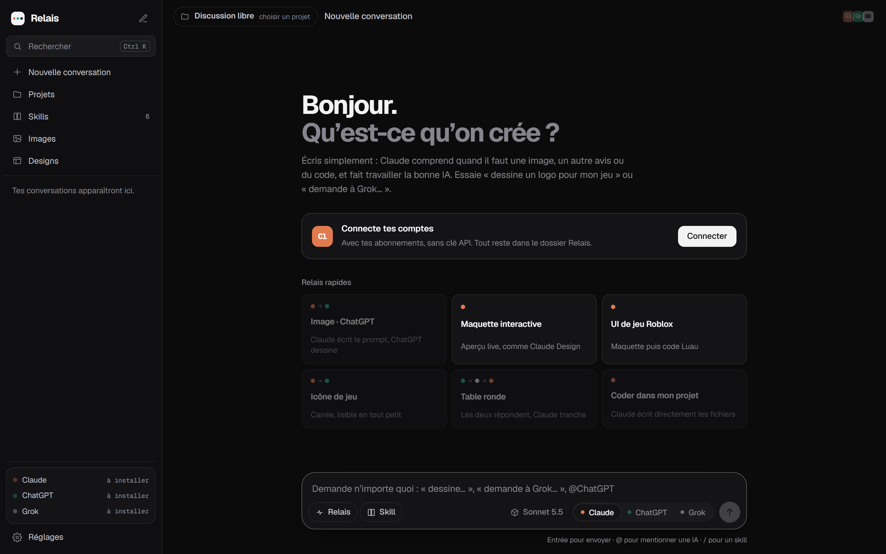
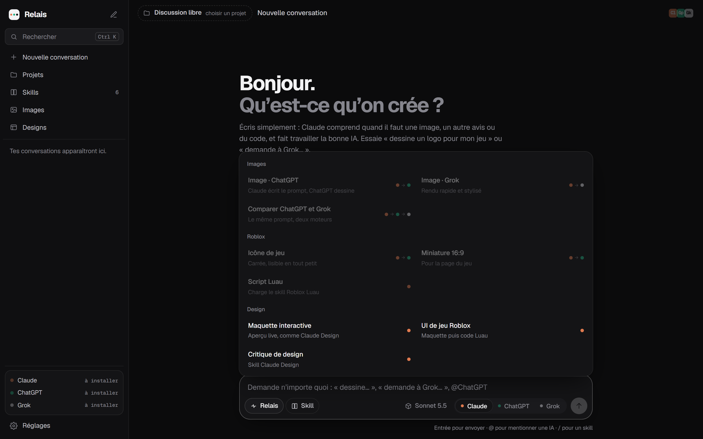
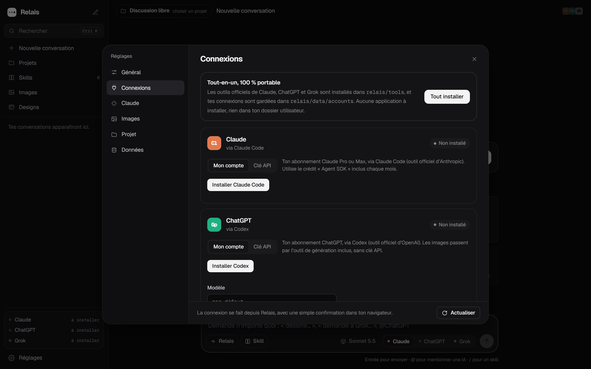

# Relais

**Un hub IA local et portable pour Windows : Claude, ChatGPT et Grok dans une seule fenêtre, connectés à tes propres comptes.**

Claude dirige les autres : tu écris simplement ce que tu veux, et Relais envoie la demande à la bonne IA. ChatGPT pour les images, Grok pour un autre avis, Claude pour le code. Tout tourne sur ton PC, dans un seul dossier, sans installer les applications de chaque IA.

| IA | Rôle | Outil officiel utilisé | Connexion |
|---|---|---|---|
| Claude | chef d'orchestre, écrit le code de ton projet | Claude Code | abonnement Pro/Max ou clé API Anthropic |
| ChatGPT | images, second avis, relecture | Codex | abonnement ChatGPT ou clé API OpenAI |
| Grok | avis différent | Grok Build | SuperGrok / X Premium+ ou clé API xAI |
| Cursor *(option)* | agent de code | `cursor-agent` | compte Cursor |

> Relais est un projet personnel. Il n'est pas affilié à Anthropic, OpenAI, xAI ni Cursor, et passe uniquement par leurs outils officiels ou leurs API.



---

## Aperçu

| Menu « Relais » : déléguer une tâche | Connexions aux comptes |
|---|---|
|  |  |

| Skills |
|---|
|  |

---

## Fonctionnalités

- **Demandes en langage naturel** : Claude comprend à qui confier quoi.
  - « dessine un logo pour mon jeu » → Claude écrit le prompt, ChatGPT génère l'image
  - « demande à Grok ce qu'il pense de… » → Grok répond, Claude commente
  - « compare l'avis de ChatGPT et Grok » → les deux répondent en parallèle, Claude tranche
  - `@ChatGPT`, `@Grok`, `@Image`, `@design` → force l'IA ou le mode voulu
- **Coder dans un projet** : choisis un dossier (par exemple un jeu Roblox synchronisé avec Rojo). Claude Code, Codex ou Grok Build y travaillent directement, chacun avec sa propre session.
- **Trois niveaux d'autorisation** : *Lecture seule*, *Demander* (chaque modification est montrée avec son diff avant d'être appliquée) et *Accès complet*.
- **Actions « Relais »** : image, icône de jeu, miniature 16:9, table ronde entre IA, script Luau…
- **Skills** : des fichiers Markdown que Claude charge tout seul quand ils servent, plus l'import de skills depuis ton compte Claude ou depuis GitHub.
- **Designs** : des maquettes HTML interactives avec aperçu en direct, des versions successives et l'export vers ton projet.
- **Application Windows** : une fenêtre WebView2 sans bordure qui reste active dans la zone de notification quand tu la fermes.
- **Portable** : Node, les outils, les connexions et les données vivent dans le dossier.

## Prérequis

- Windows 10 ou 11 (WebView2 est déjà présent sur Windows 11)
- [Node.js](https://nodejs.org) 18.17 ou plus récent, installé sur le PC **ou** en version portable dans `node/`
- Un compte ou une clé API pour au moins une des IA

## Installation

```bash
git clone https://github.com/<ton-compte>/relais.git
cd relais
```

1. **Node.js** : soit Node est installé sur le PC, soit tu télécharges l'archive « Windows Binary (.zip) » sur [nodejs.org](https://nodejs.org/en/download) et tu mets son contenu dans `node/` (`node/node.exe`).
2. **Le lanceur** (optionnel, recommandé) : compile `Relais.exe` avec le compilateur C# fourni avec Windows :

   ```bash
   powershell -ExecutionPolicy Bypass -File launcher\build.ps1
   ```

3. **Les clés API** (optionnel) : copie `.env.example` en `.env` et remplis les clés. Tu peux aussi les saisir dans l'app (Réglages → Connexions).

Aucune dépendance npm à installer : le serveur n'utilise que Node.

## Lancer

- **`Relais.exe`** : démarre le serveur en arrière-plan et ouvre l'interface dans sa propre fenêtre. Fermer la fenêtre laisse Relais actif près de l'horloge. Double-clic sur l'icône pour rouvrir, clic droit → *Quitter Relais* pour tout arrêter.
- **`demarrer.bat`** : solution de secours qui ouvre l'interface dans ton navigateur, avec une console.
- **Manuellement** : `npm start`, puis ouvre <http://127.0.0.1:4321>.

## Connecter tes comptes

Réglages → **Connexions**, pour chaque IA :

1. **Installer** : télécharge l'outil officiel dans `tools/` (Claude Code ≈ 355 Mo, Codex ≈ 490 Mo, Grok Build via le script officiel de xAI).
2. **Se connecter** : ton navigateur s'ouvre pour te connecter à ton compte.
3. **Tester** : envoie un message de test.

Chaque IA peut aussi être branchée par **clé API**. Les images Grok passent toujours par une clé API xAI.

Bon à savoir :
- Claude Code en mode automatique consomme le crédit « Agent SDK » inclus dans les abonnements Pro et Max (séparé de la limite du chat).
- Générer des images avec ChatGPT via Codex consomme les limites de l'abonnement plus vite qu'un message texte.

## Configuration

Les variables de `.env.example` :

| Variable | Rôle | Défaut |
|---|---|---|
| `ANTHROPIC_API_KEY`, `OPENAI_API_KEY`, `XAI_API_KEY` | clés API (mode clé API) | vide |
| `CLAUDE_MODEL` | modèle Claude | `claude-sonnet-5-5` |
| `OPENAI_MODEL`, `OPENAI_IMAGE_MODEL` | modèles OpenAI | `gpt-5`, `gpt-image-1` |
| `GROK_MODEL`, `GROK_IMAGE_MODEL` | modèles xAI | `grok-4`, `grok-2-image` |
| `CURSOR_ENABLED`, `CURSOR_WORKSPACE`, `CURSOR_COMMAND`, `CURSOR_ALLOW_WRITES` | agent Cursor | désactivé |
| `PORT` | port du serveur local | `4321` |

## Structure

```
server.js             serveur HTTP local + flux en direct
lib/connectors.js     outils officiels : installation, connexion, exécution
lib/orchestrator.js   logique de délégation (modes compte et clé API)
lib/mcp-bridge.js     pont MCP : donne à Claude Code les outils de Relais
lib/coders.js         agents de code dans un projet (Claude Code, Codex, Grok Build)
lib/relays.js         actions « Relais »
lib/skills.js         skills : lecture, packs, activé/désactivé
lib/skill-import.js   import depuis le compte Claude et GitHub
lib/designs.js        maquettes HTML (aperçu, export vers le projet)
lib/providers.js      appels API directs
public/               interface web
skills/               skills Relais (Markdown)
launcher/             lanceur Windows (C# + WebView2) et script de compilation
docs/screenshots/     captures d'écran du README
```

Créés à l'utilisation et exclus du dépôt : `node/` (Node portable), `tools/` (outils officiels), `data/` (connexions, conversations, images, réglages) et `skills/packs/` (skills importés).

## Sécurité et vie privée

- Le serveur écoute uniquement sur `127.0.0.1` : il n'est pas accessible depuis le réseau.
- Tes connexions aux comptes sont dans `data/accounts/`. Supprimer ce dossier déconnecte tout. **Ne partage jamais ce dossier.**
- Les dossiers trop larges (disque entier, dossier utilisateur, Bureau, Documents…) sont refusés comme dossier de projet.
- En *Accès complet*, les agents modifient ton projet sans confirmation : garde une sauvegarde (Git).

## Crédits

- Fenêtre : [Microsoft Edge WebView2](https://developer.microsoft.com/microsoft-edge/webview2/). Les bibliothèques redistribuables du SDK sont dans `launcher/lib/`.
- Les skills importés gardent la licence de leur dépôt d'origine.
